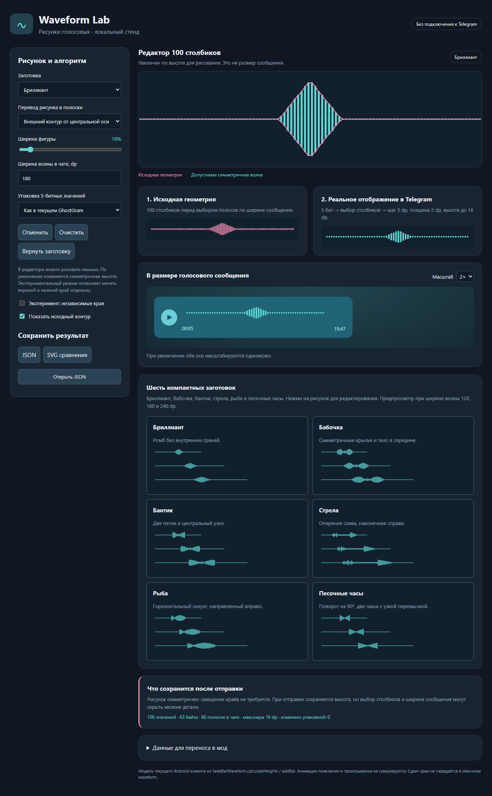

# Waveform Lab

Draw compact waveform patterns for Telegram-style voice messages in an offline browser editor.



## Try it

Open **index.html** directly. No server, installation, account or network connection is needed.
Draw with the mouse, undo changes, load one of six presets, save/load JSON, or export SVG.
The preview shows how the same compact data looks at several message widths.

## Reproduce and check

Install Node.js 18+ and JDK 17+, then:

```sh
npm run generate
npm test
```

The generator updates `optimized.js` and `reference/WaveformPresets.java`.
Tests compile extracted Java packing/reading method bodies and compare them with
the JS implementation on deterministic fixtures, including byte-boundary cases.
All required reference sources are in this repository; a Telegram checkout is not needed.

`engine.js` contains packing, display geometry and contour conversion.
`approved-presets.js` is the source of the six presets.
Optional browser checks in `dev/` require Playwright.

## Limits

The ordinary format stores 100 five-bit amplitudes (0–31), not an arbitrary image.
Holes and asymmetric contours are approximations. This editor does not send
messages or modify an installed Telegram client. See NOTICE.md for attribution.

Русский: автономный редактор рисунков для голосовых волн; откройте index.html.
